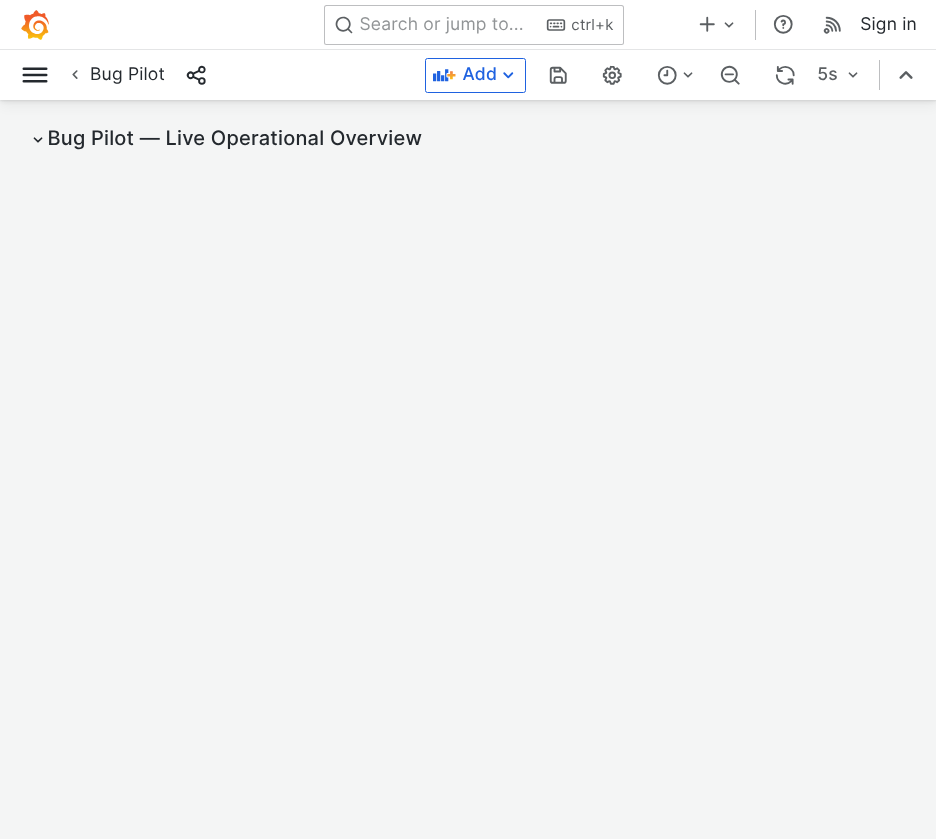
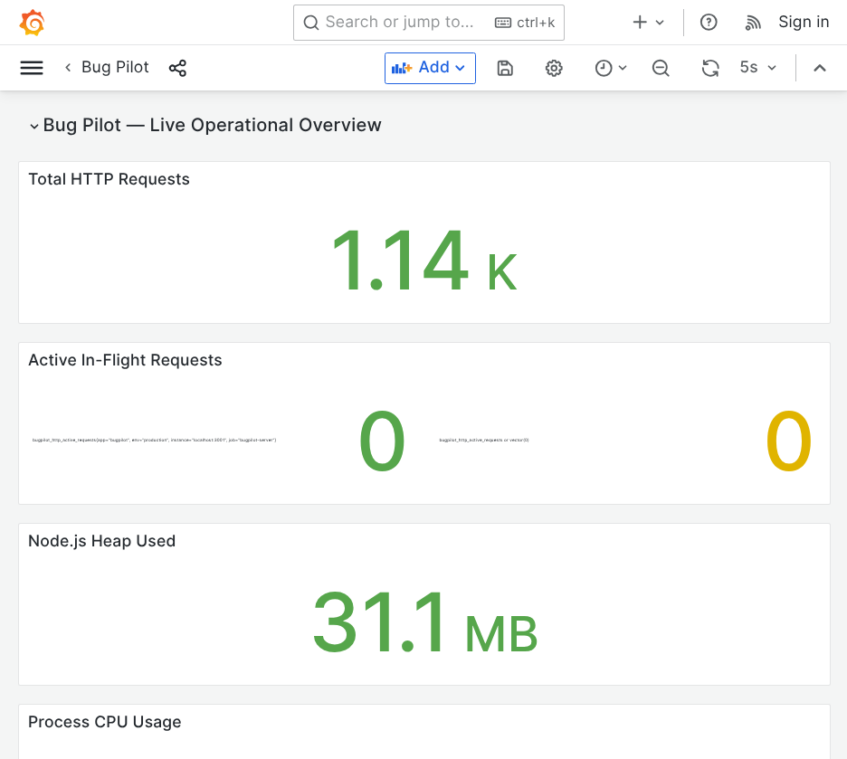
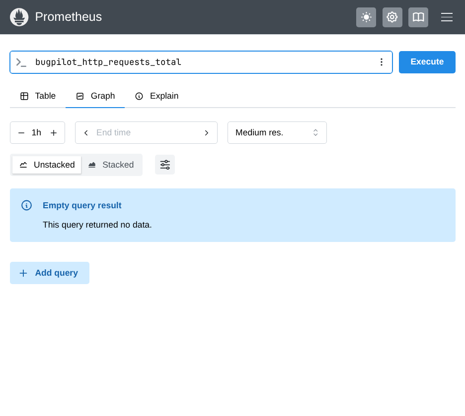
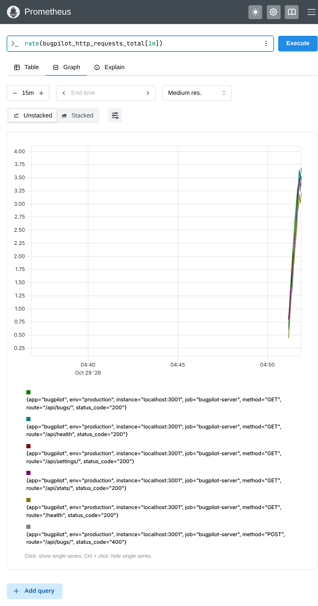

# Bug Pilot Monitoring & Observability Stack

This folder contains the complete Prometheus and Grafana monitoring configuration for Bug Pilot.

## Structure
- `prometheus.yml`: Prometheus scrape configuration targeting Bug Pilot backend `/metrics`.
- `docker-compose.monitoring.yml`: Standalone Docker Compose file for running Prometheus and Grafana.
- `provisioning/datasources/prometheus.yml`: Automatic Prometheus data source registration in Grafana.
- `provisioning/dashboards/dashboards.yml`: Automatic dashboard provider configuration for Grafana.
- `provisioning/dashboards/bugpilot_dashboard.json`: The complete Grafana dashboard definition for Bug Pilot.
- `scripts/simulate_traffic.js`: Automated traffic & load generator for testing metrics under load.
- `assets/`: Dashboard comparison screenshots under idle and loaded states.

---

## How to Run Load Simulator
To test metrics under realistic load:
```bash
# node monitoring/scripts/simulate_traffic.js [duration_seconds] [concurrency]
node monitoring/scripts/simulate_traffic.js 45 5
```

---

## Dashboard Visual Comparisons (Light Mode)

### 1. Grafana Dashboard
| State | Screenshot | Description |
| :--- | :--- | :--- |
| **Idle** |  | 0 req/sec, minimal baseline memory/CPU |
| **Under Load** |  | 1,140+ requests, active in-flight tracking, elevated throughput |

### 2. Prometheus Expression & Graph
| State | Screenshot | Description |
| :--- | :--- | :--- |
| **Idle** |  | Query returns empty result when no requests have arrived |
| **Under Load** |  | Multi-series graph showing per-route request rates over time |

---

## How to Run the Monitoring Stack

### Option 1: Standalone Monitoring Containers
```bash
docker compose -f monitoring/docker-compose.monitoring.yml up -d
```
- Grafana: `http://localhost:3000` (User: `admin`, Password: `admin`)
- Prometheus: `http://localhost:9090`

### Option 2: Full Stack (App + Monitoring)
```bash
docker compose up -d
```
- Frontend: `http://localhost:8080`
- Backend API: `http://localhost:3001`
- Metrics: `http://localhost:3001/metrics`
- Grafana: `http://localhost:3000`
- Prometheus: `http://localhost:9090`
