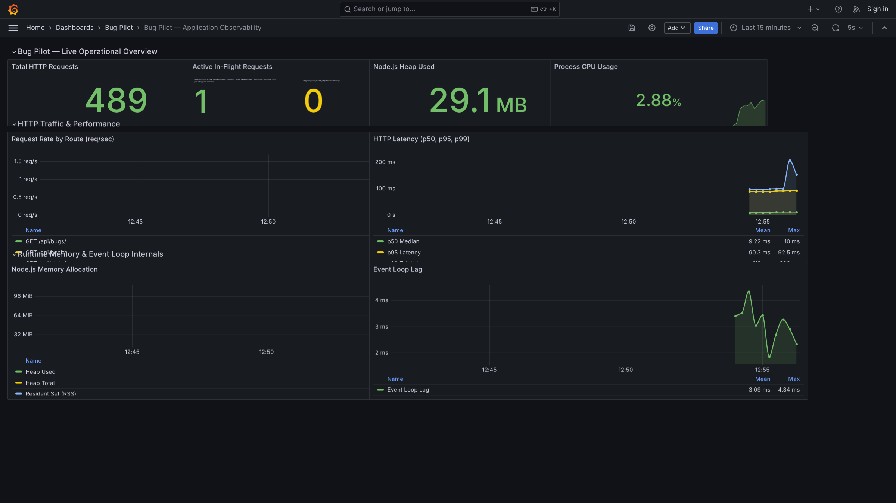

# Bug Pilot Monitoring & Observability Stack

This folder contains the complete Prometheus and Grafana monitoring configuration for Bug Pilot.

## Structure
- `prometheus.yml`: Prometheus scrape configuration targeting Bug Pilot backend `/metrics`.
- `docker-compose.monitoring.yml`: Standalone Docker Compose file for running Prometheus and Grafana.
- `provisioning/datasources/prometheus.yml`: Automatic Prometheus data source registration in Grafana.
- `provisioning/dashboards/dashboards.yml`: Automatic dashboard provider configuration for Grafana.
- `provisioning/dashboards/bugpilot_dashboard.json`: The complete Grafana dashboard definition for Bug Pilot.
- `assets/`: Live dashboard screenshots and visuals.

## Dashboard Preview


## How to Run

### Option 1: Standalone Monitoring Containers
```bash
docker compose -f monitoring/docker-compose.monitoring.yml up -d
```
- Grafana: `http://localhost:3000` (User: `admin`, Password: `admin`)
- Prometheus: `http://localhost:9090`

### Option 2: Full Stack (App + Monitoring)
From the repository root:
```bash
docker compose up -d
```
- Frontend: `http://localhost:8080`
- Backend API: `http://localhost:3001`
- Metrics: `http://localhost:3001/metrics`
- Grafana: `http://localhost:3000`
- Prometheus: `http://localhost:9090`

## Tracked Metrics
- `bugpilot_http_requests_total`: Total requests partitioned by method, route, and status code.
- `bugpilot_http_request_duration_seconds`: Request latency histogram (p50 median, p95 latency, p99 tail latency).
- `bugpilot_http_active_requests`: Real-time active in-flight requests.
- `bugpilot_nodejs_heap_size_used_bytes` / `total_bytes`: V8 engine heap memory utilization.
- `bugpilot_process_resident_memory_bytes`: Total RSS memory.
- `bugpilot_process_cpu_seconds_total`: Process CPU load.
- `bugpilot_nodejs_eventloop_lag_seconds`: Node.js event loop latency.
